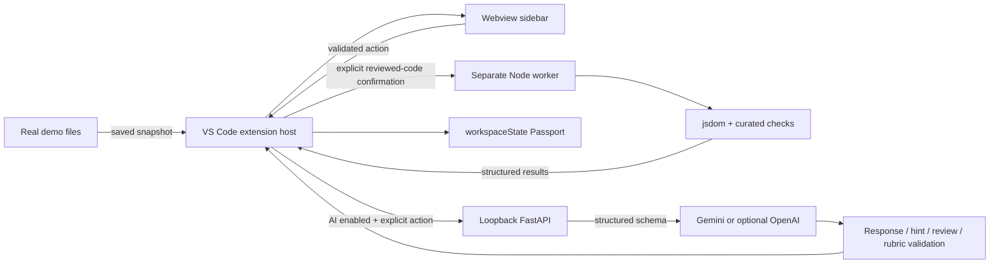

# Architecture and trust boundaries

## Learning loop



Offline mode never instantiates an AI request. The backend is optional: curriculum, scripted hints, quizzes, test execution and persistence all live in the extension. `shared/guided-projects.json` is the source of truth. The build copies it and the runner into `extension/runtime`; do not edit those generated copies.

Mode A stores multiple roadmaps and milestone histories in workspace state. Learners explicitly approve one selected snippet or current file before code is sent to the backend. `CodeContext.ts` restricts paths, size and common secrets; FastAPI checks consent and secrets again. `POST /mentor/review` returns schema-validated advisory observations, unknowns and next actions with `verification_status` fixed to `unverified`. It never invokes the guided test runner. Mode B's authored To-Do List is the only path that can record verified implementation checks.

## Components

- `MentorPanel.ts` receives whitelisted, reconstructed messages. A busy guard serializes user actions. It coordinates files, tests, hints and assessments.
- `Lab.ts` restricts reads/writes to a dedicated marked `codesense-lab` in the first local workspace folder. It rejects linked lab directories and linked/oversized files and never overwrites existing demo work. Each run uses one captured snapshot; edits during the confirmation or run cannot change what executes.
- `process.cjs` launches a worker without a shell and without inherited API keys, NODE_OPTIONS or ordinary environment secrets. stdin carries three bounded source strings. stdout carries bounded structured JSON. The parent kills the worker after eight seconds.
- `checks.cjs` creates a fresh document per check. No external jsdom resource loader is enabled. Milestone 1 never evaluates learner JavaScript. Milestone 2 evaluates the controlled app.js and dispatches events. No learner code executes in the extension host or FastAPI process.
- `BackendClient.ts` allows only loopback HTTP URLs, rejects redirects and has a request timeout. All network requests originate in the extension host; webview CSP has `connect-src 'none'`.
- FastAPI validates inputs through Pydantic, rejects browser-origin POSTs, allows loopback Host headers, limits concurrent AI requests and applies a total timeout. This local development service is not authenticated or intended for internet exposure. CORS is not enabled.
- The provider uses server-side environment credentials, configurable Gemini/OpenAI model selection and official SDK structured responses, with no tools or shell execution. The OpenAI path uses `store=False`. Neither provider receives code without the extension's explicit sharing action; frontend and backend secret checks are heuristic, so the learner must review the consent snapshot.

## Result authority

**Verified tests** are the reviewed predefined suites documented in TEST_COVERAGE. Only these set implementation correctness. **Provisional checks** would require explicit review before gaining this authority; V1 has no provisional execution path. **Exploratory AI suggestions** (custom roadmap acceptance criteria and conceptual feedback) never set implementation results. A test passing is evidence about the tested requirements, not proof that the application is universally correct.

## Local persistence schema

VS Code `workspaceState`, key `codesense.passport.v1`:

```text
schemaVersion: 1
milestones[id]:
  testAttempts, recoveryAttempts
  latestTests, latestRecovery: {results, totals, passed, validity, kind, at, sourceHash}
  history: last 50 result sets
  hintsRequested, highestHintLevel, hints: last 10 texts
  explanation: {passed, source, correct, missing, feedback, at}
  explanationAttempts
  revealed, revealedAt, recoveryStatus
  currentHash
```

`codesense.customProjects.v1` stores up to 20 full custom roadmaps, each with a stable ID, learning level when known, current milestone, advisory review attempts, hints, explanations, assistance, conceptual outcomes and self-reported progress. `activeProjectId` selects the project shown in the workspace; an immutable roadmap milestone index associates its evidence. The older `codesense.roadmap` value is read for migration and never deleted or overwritten. A Passport summary cannot reconstruct a missing roadmap. Raw learner source and API keys are not persisted in Passport; custom explanation text and model feedback are retained in the custom-project record. Explicitly shared selections may be reflected in generated feedback. Data is local but not encrypted by this application. Normal VS Code profile storage rules apply. No cloud sync key is registered.

Classification is derived, not a made-up percentage:

1. Revealed + currently passing implementation + currently passing recovery + post-reveal conceptual pass → **Recovered Understanding**.
2. Any other revealed state → **Assisted**.
3. Current implementation pass + concept pass → **Understanding Verified**.
4. Current implementation pass alone → **Implementation Verified**.
5. Any assessment/test/hint activity → **In Progress**; otherwise **Not Started**.

A passing concept result can coexist with failing code. The first reveal clears earlier conceptual verification, requiring explain-back afterward. Recovery suites include all original checks. Hashing all three demo files conservatively invalidates current implementation/recovery status on edits, saves, deletions, external changes and reopening; past attempts remain visible. Unsaved code is not marked as tested. The Run action saves demo documents before taking a snapshot. History is bounded while lifetime attempt counters are retained. A new workspace starts a separate Passport.

## Important execution limitation

Neither `node:vm` nor jsdom provides a security boundary against malicious JavaScript. The memory option limits the V8 heap, not total process memory. A separate process and timeout limit common accidents but do not block operating-system access, network access after an escape, or spawned descendants. Environment scrubbing does not hide files on disk. Hostile code may forge test results. Therefore V1 is restricted to code the learner wrote/reviewed in the controlled demo; explicit per-run approval and workspace trust are mandatory. No automatic editor hooks run code. Strong OS/container isolation is future work.

## Extending the prototype

Add a milestone schema, authored reference, deterministic requirements and checks, seeded defects, conceptual rubric and recovery checks together. Review requirement-to-test coverage before labelling a suite verified. Do not attach arbitrary AI-generated tests to completion. See IMPLEMENTATION_STATUS for the finals/V2 boundary.
